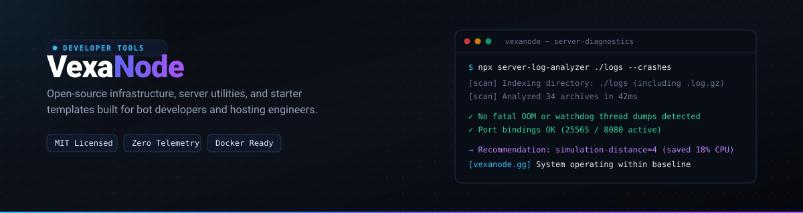

<div align="center">



# VexaNode Open-Source Ecosystem 🚀

**Production-grade frameworks, automation utilities, and infrastructure blueprints for developers and server administrators.**

[](https://vexanode.gg)
[](https://discord.gg/devz)
[](LICENSE)
[](https://github.com/VexaNode-Dev)

[Explore Repositories](#-open-source-projects) • [Hosting Infrastructure](https://vexanode.gg) • [Community Discord](https://discord.gg/devz) • [Contributing](CONTRIBUTING.md)

</div>

---

## ⚡ Welcome to VexaNode-Dev

Welcome to the official open-source organization for **[VexaNode](https://vexanode.gg)**. We craft battle-tested tools, starter templates, and configuration standards designed to save developers and community creators hundreds of hours when launching bots, tuning game servers, and running cloud workloads.

Whether you're developing your first slash-command Discord bot, squeezing maximum tick performance out of a 500-player Minecraft network, or automating Pterodactyl backups, our repositories provide production-ready foundations with zero fluff.

---

## 📦 Featured Open-Source Repositories

| Repository | Tech Stack | Description | Highlights |
| :--- | :--- | :--- | :--- |
| **[`discordjs-v14-bot-template`](https://github.com/VexaNode-Dev/discordjs-v14-bot-template)** | TypeScript / Node.js 20+ | Production Discord.js v14 slash command bot starter. | Autocomplete, modals, buttons, sharding manager, Docker & Pterodactyl ready. |
| **[`discordpy-bot-template`](https://github.com/VexaNode-Dev/discordpy-bot-template)** | Python 3.11+ / Discord.py 2.x | Asynchronous Python Discord bot framework with cogs. | Hybrid commands, Rich logger, SQLite/PostgreSQL async layer, Dockerized. |
| **[`minecraft-server-optimization-guide`](https://github.com/VexaNode-Dev/minecraft-server-optimization-guide)** | Paper / Purpur / Folia / Node.js | Complete Minecraft server optimization configs & audit CLI tool. | 1.20-1.21 configs, modern Aikar/ZGC flags, automated config audit script. |
| **[`pterodactyl-backup-manager`](https://github.com/VexaNode-Dev/pterodactyl-backup-manager)** | TypeScript / Node.js / CLI | Automated backup creation, download, retention & Discord notifications for Pterodactyl. | Zero rate-limit issues, S3/local sync, webhook alerts, cron scheduler. |
| **[`node-vps-deploy`](https://github.com/VexaNode-Dev/node-vps-deploy)** | Bash / Linux Shell | Automated VPS hardening, Node.js LTS, PM2, Nginx reverse proxy & SSL setup. | One-line deploy, UFW security, fail2ban, zero-downtime reload. |
| **[`docker-server-monitoring`](https://github.com/VexaNode-Dev/docker-server-monitoring)** | Docker Compose / Prometheus | Turnkey monitoring stack for VPS, bot nodes, and game servers. | Prometheus, Grafana, cAdvisor, Node Exporter, pre-built dashboards & alerts. |

---

## 🎯 Architecture Pillars

Every project published under **VexaNode-Dev** adheres to strict engineering benchmarks:

1. **Production-Ready by Default**
   - No half-baked pseudocode. Every repo includes real working source code, type definitions, environment validation, and automated test coverage.
2. **Container & Cloud First**
   - Out-of-the-box support for Docker, Docker Compose, Pterodactyl Panel eggs, and standard cloud VPS environments (such as [VexaNode Cloud](https://vexanode.gg)).
3. **Comprehensive Documentation & SEO-Friendly Knowledge**
   - In-depth READMEs, configuration guides, troubleshooting steps, and actionable benchmarks to help developers solve real operational problems.
4. **Permissive Open-Source Licensing**
   - 100% open-source under the permissive [MIT License](LICENSE). Fork, modify, and integrate freely into personal or commercial projects.

---

## 🛠️ Quick Starter Guides

### 🤖 Launching a Discord Bot (Node.js or Python)
```bash
# Clone the Discord.js v14 TypeScript Template
git clone https://github.com/VexaNode-Dev/discordjs-v14-bot-template.git my-bot
cd my-bot && npm install

# Or clone the Discord.py Asynchronous Template
git clone https://github.com/VexaNode-Dev/discordpy-bot-template.git my-python-bot
cd my-python-bot && pip install -r requirements.txt
```

### ⚡ Auditing Your Minecraft Server Performance
```bash
# Clone and run the configuration auditor
git clone https://github.com/VexaNode-Dev/minecraft-server-optimization-guide.git
cd minecraft-server-optimization-guide
node bin/mc-perf-audit.js --path /path/to/server
```

### 🔒 Hardening a Clean Linux VPS
```bash
# Clone and inspect the VPS setup utility
git clone https://github.com/VexaNode-Dev/node-vps-deploy.git
cd node-vps-deploy && sudo ./deploy.sh --dry-run
```

---

## 🌐 Powered by VexaNode

The tools and configurations maintained in this organization are inspired by real-world workloads hosted on [VexaNode](https://vexanode.gg):

- **[Discord Bot Hosting](https://vexanode.gg)** – High-uptime Node.js, Python, Java, and Go containerized hosting with instant 24/7 online status.
- **[Minecraft Server Hosting](https://vexanode.gg)** – Extreme single-core clock speeds, DDR5 RAM, and NVMe Gen4 storage tailored for Paper, Purpur, Fabric, and Forge.
- **[KVM VPS Infrastructure](https://vexanode.gg)** – Unmetered bandwidth, enterprise DDoS mitigation, and instantaneous deployment across Tier-3 datacenters.

---

## 🤝 Community & Support

Have questions, need help setting up, or want to contribute?
- 💬 **Discord Community:** Join thousands of developers and creators at [discord.gg/devz](https://discord.gg/devz).
- 🐛 **Issue Tracker:** Found a bug or need a feature? Open an issue on the relevant repository.
- 💡 **Discussions:** Start a thread on GitHub or chat with us in our community Discord.

---

<div align="center">
  <sub>Built with ❤️ by the <b>VexaNode</b> engineering team &amp; open-source contributors.</sub><br/>
  <sub>© 2026 VexaNode. Open source under the MIT License.</sub>
</div>
